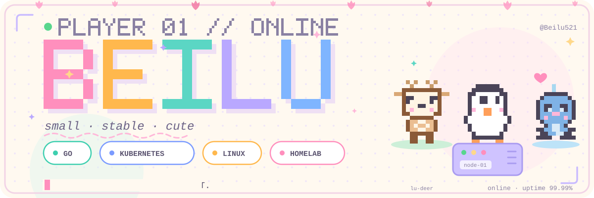

  

## [ PLAYER PROFILE ]

你好，我是 **Beilu** —— Go 方向的运维开发学习者。

- **OttoStack**：正在造的玩具版 PaaS，学 K8s 顺手把它写出来
- 信条：`BUILD. SHIP. OPERATE. REPEAT.`

> _"Time boils the rain, years weave flowers, with a joyful heart, pace through the mundane."_

## [ INVENTORY ]

**LANGUAGES** 

**TOOLS** 

**INTERESTS**　`Homelab` `SRE` `平台工程` `自动化`

## [ SNAKE ]

  <picture>
    <source media="(prefers-color-scheme: dark)" srcset="https://raw.githubusercontent.com/Beilu521/Beilu521/output/github-snake-dark.svg"/>
    
  </picture>

